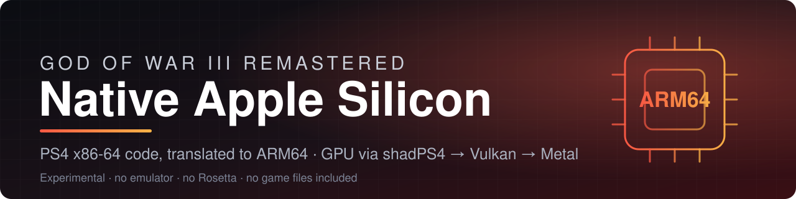
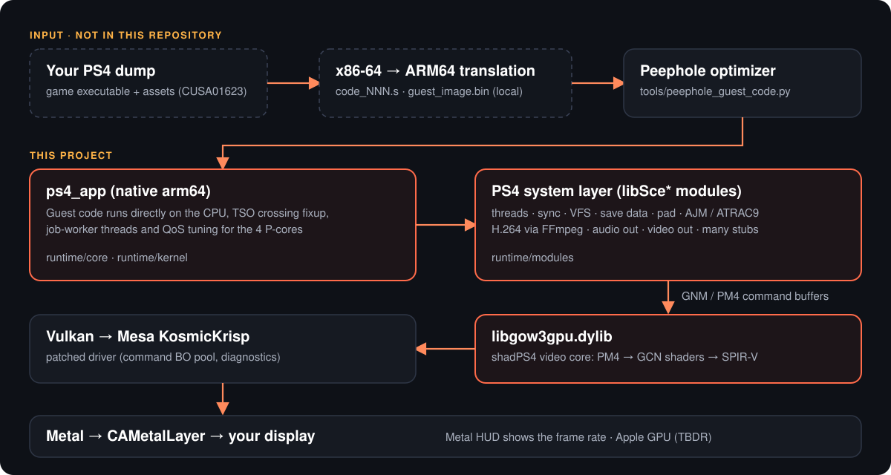

<div align="center">



<br>


[](LICENSE)

**A native Apple Silicon runtime for *God of War III Remastered* (PS4, CUSA01623).**<br>
The game's x86-64 code is translated to ARM64 and runs directly on the CPU. Graphics go through the
shadPS4 video core to **Vulkan**, and Mesa's **KosmicKrisp** driver carries them to **Metal**.

[Specs](#specs) · [Status](#status) · [How it works](#how-it-works) · [Limitations](#limitations) ·
[Roadmap](#roadmap--to-be-improved) · [Build](#building) · [Run](#running) · [Credits](#credits)

</div>

---

> [!IMPORTANT]
> **No game files are included in this repository, and none ever will be.** You need your own legally
> obtained dump from your own PlayStation 4. This project is not affiliated with, endorsed by or
> sponsored by Sony Interactive Entertainment or Santa Monica Studio. *God of War* is a trademark of
> Sony Interactive Entertainment. Please do not open issues or pull requests that ask for, link to or
> contain game files, keys or dumps.

> [!NOTE]
> **This is an experimental, single-maintainer project built in personal time.** It boots, reaches the
> menu and plays, but it is not finished: heavy scenes run below 60 FPS, and several parts are
> unverified or still to be built. The [limitations](#limitations) and the
> [roadmap](#roadmap--to-be-improved) below are honest about what is missing and why.

## Highlights

| | |
|---|---|
| 🧠 **Native CPU code** | The game's x86-64 code is translated ahead of time to ARM64 and runs directly on the CPU. No emulator, no Rosetta. |
| 🎨 **Vulkan → Metal graphics** | The shadPS4 video core translates PS4 GPU commands and GCN shaders to Vulkan; Mesa KosmicKrisp turns Vulkan into Metal. |
| 🍎 **Tuned for Apple Silicon** | Handles the x86 memory-ordering faults of Apple's TSO mode, tunes threads for the 4 performance cores, and persists the driver's pipeline cache. |
| 🔊 **Full audio path** | ATRAC9 and MP3 decoding, CoreAudio output, slice-threaded H.264 cutscene video. |
| 📊 **Built to be measured** | Frame stats, pass and submit tracers, Metal encoder tracing, a gameplay benchmark harness and an A/B script ship with the code. |
| 🧪 **Honest engineering notes** | `docs/engineering` records what was tried, what worked and what was rejected, with numbers. |

## Specs

### Tested hardware (the only configuration verified)

| | |
|---|---|
| **Machine** | MacBook Air (`Mac14,2`), fanless |
| **Chip** | Apple M2: 4 performance + 4 efficiency cores |
| **GPU** | Apple M2 GPU, 10 cores, Metal 4 |
| **Memory** | 16 GB unified |
| **Display** | 2560 × 1664 Retina (the game renders at 1080p by default) |
| **OS** | macOS 27.0 (build 26A428), SDK 27.0 |

### Toolchain used to build and test

| | |
|---|---|
| **Compiler** | Apple clang 21.0.0 |
| **Build tools** | Ninja 1.13.2, CMake 4.4.4, Python 3.9.6 (system) |
| **Video** | FFmpeg 9.0.2 (Homebrew) |
| **Vulkan driver** | Mesa KosmicKrisp, revision `09a9fae26d5df276a23b3f66050cd0d1d227800a`, release build with the patches in `scripts/lab/patches/` |
| **GPU library** | `libgow3gpu.dylib`: the shadPS4 video core with God of War III fixes, arm64, Release |

### Requirements to build it yourself

- An **Apple Silicon** Mac. Intel and Rosetta are not supported (the build script refuses to run).
- **Xcode command line tools**, **Homebrew**, and the packages the build files ask for: `ninja`,
  `cmake`, `pkg-config`, `ffmpeg`, `freetype`, `fmt`, `boost`, `sdl3`, `spirv-cross`, `xxhash`,
  `zydis`, `robin-map`, the Vulkan headers and `llvm` (for `llvm-ar`). The authoritative lists are the
  `find_package` / `pkg_check_modules` calls in `third_party/gow3gpu/gpu/CMakeLists.txt` and the flags
  in `tools/generate_build_ninja.py`.
- **Meson** and Mesa's build dependencies if you build the Vulkan driver yourself.
- Your own **game dump**, on a volume that is not read-only.

## Status

| Area | State | Notes |
|---|---|---|
| Boot, menus, loading a save | ✅ Works | Verified on the M2 Air |
| Gameplay | ✅ Works | Opening combat and a loaded Mount Olympus save were used for testing |
| Frame rate, light scenes | ✅ About 60 FPS | About 700 draws per frame |
| Frame rate, heavy scenes | ⚠️ About 30 to 45 FPS | 2,000+ draws per frame; the GPU is the limit |
| Audio: music, voices, effects | ✅ Works | ATRAC9 and MP3 |
| Cutscene audio/video sync | ⚠️ Not fully solved | Audio can trail the picture |
| Cutscene video | ⚠️ Unverified | Slice-threaded H.264 decode; not yet checked over a full cutscene |
| Pipeline cache between launches | ✅ Works | Pipeline build time 28.6 s → 2.5 s on a warm cache |
| Other Apple Silicon chips | ❓ Untested | Only an M2 has been used |
| Building from a fresh clone | ❌ Not possible yet | See [Limitations](#limitations) |

### Benchmarks

Measured on the machine above with Metal's HUD on and `docs/handoff/bench/`. Numbers depend on the
scene, so rows are only comparable inside the same scene (the draws-per-flip column identifies it),
and the machine was **not fully idle** (load average 2 to 5), so treat differences of a few FPS as
noise.

**Light scene** (about 727 draws per frame; the 60 Hz display caps it):

| Build | Runs | Mean FPS | 95th-percentile frame |
|---|---|---|---|
| Previous runtime | 1 | 50.1 | 33.4 ms |
| This version, all configurations | 6 | 59.6 to 60.0 | 16.7 ms |

**Heavy scene** (2,270 to 2,486 draws per frame; one run per configuration):

| Configuration | Mean FPS | 95th-percentile frame |
|---|---|---|
| Guest TSO checks on | 39.4 | 33.4 ms |
| TSO checks off + QoS switches | 41.0 | 33.4 ms |
| + 2 draw-prep workers | 37.9 | 33.4 ms |

**Highest sustained gameplay frame rate: 60.0 FPS** (display-capped, light scene). In the heavy scene
this build runs about 38 to 41 FPS, in line with the 38 to 45 FPS recorded earlier. The heavy-scene
differences are single samples inside the run-to-run noise, so they do not show that any switch helps.
Full tables, loads and caveats: [`docs/engineering/AB_ARGON_20261026.md`](docs/engineering/AB_ARGON_20261026.md).

## How it works



- **CPU.** Guest code is translated ahead of time to ARM64 assembly. `tools/peephole_guest_code.py`
  rewrites hot patterns, and `runtime/core/tso_crossing.c` handles the x86 memory-ordering cases that
  Apple Silicon's hardware TSO mode faults on (accesses that cross a 16-byte boundary).
- **System layer.** `runtime/` implements the PS4 kernel and the `libSce*` modules the game imports:
  threads, semaphores, event queues, fibers, the file system, video out, audio out, ATRAC9 through AJM,
  H.264 through FFmpeg, pad, save data and many stubs.
- **GPU.** `third_party/gow3gpu` is a fork of the shadPS4 video core with God of War III rendering
  fixes, built as `libgow3gpu.dylib` and loaded by the runtime. It translates PM4 command buffers and
  GCN shaders to Vulkan.
- **Vulkan to Metal.** Mesa's KosmicKrisp Vulkan driver, with the patches in `scripts/lab/patches/`.

## Explore without the game

You can read, build and test large parts of this project without owning or dumping the game:

```bash
# 14 Python tests (audio metrics, build-graph idempotence, shader translation, replay, trace analysis, ...)
python3 -m unittest discover -s tests

# the GPU library (shadPS4 video core with the God of War III fixes), arm64
cmake -S third_party/gow3gpu/gpu -B /tmp/gow3gpu-arm64-build -DCMAKE_BUILD_TYPE=Release -DGOW3_LTO=OFF
cmake --build /tmp/gow3gpu-arm64-build --parallel 8
```

The engineering notes in [`docs/`](docs/README.md) are the best starting point: they show how the
runtime was profiled and tuned, including measurements that disproved several assumptions.

## Limitations

Be aware of these before you try it:

- **You cannot build a working `ps4_app` from a fresh clone yet.** The build needs `guest_image.bin`
  and `code_NNN.s`, which are produced from your own copy of the game's executable. The translator
  that produces them is not in this repository yet. Everything else in the repository builds.
- **Heavy scenes are GPU-bound.** In scenes with 2,000+ draws per frame the M2 Air runs about 30 to
  45 FPS. Sustained load also heats a fanless machine, which lowers clocks over time.
- **Only one machine has been tested:** an M2 MacBook Air with 16 GB. Other chips, other memory sizes
  and other macOS versions are unverified.
- **Cutscene audio can trail the picture**, and the H.264 cutscene path has not been verified end to
  end after the threading change.
- **No sparse buffer residency.** Neither KosmicKrisp nor MoltenVK exposes it, so the video core uses a
  range-backed fallback that has not been validated against every guest resource.
- **The runtime reports PS4 Pro mode while the GPU library assumes the base console.** No visible
  effect has been found, but the two sides should agree.
- **Defaults changed but not yet benchmarked end to end:** guest TSO checks are off outside the known
  crossing functions (an unprofiled crossing costs about 2 µs per fault), and the QoS and draw-prep
  switches are opt-in because earlier measurements went against them.
- **Manual setup.** There is no installer or `.app` bundle. The GPU library and Vulkan driver are
  built by hand and installed with `scripts/lab/install_runtime.sh`.
- **The pipeline cache is large**, a few hundred MB under the shader directory, and is written in the
  background once a minute while it grows.
- **Limited automated testing.** The tests are mostly CPU-side policy checks. A passing test does not
  prove correct rendering or gameplay, and there is no CI.

## Roadmap / to be improved

> These items are open because of **limited personal time and limited test hardware** (one developer,
> one M2 MacBook Air), not because they were ruled out. Items that were investigated and found not to
> help are listed separately below.

**Packaging and reproducibility**
- [ ] Document or add the x86-64 → ARM64 translation step so a fresh clone can be built.
- [ ] Persistent build locations for the GPU library and driver (they default to `/tmp`), plus a single
      bootstrap script and a `.app` bundle.
- [ ] Removal of machine-specific paths from the launchers and docs.
- [ ] CI for the parts that do not need the game (build, unit tests, shader tests).

**Performance**
- [ ] Repeat the A/B benchmarks on an idle machine with several scenes and rounds, to confirm what
      the TSO-off build and the QoS switches really gain.
- [ ] Reduce heavy-scene GPU time: internal resolution scaling that adapts to thermal pressure, and
      moving staging copies ahead of render work to cut encoder splits.
- [ ] Batch the compute stage of consecutive tessellated draws (upper bound measured at about 2 to 3 FPS).
- [ ] Compile compute and tessellation shaders away from the GPU thread (today a shader's first
      sighting stalls it for a few to a few tens of ms; all later launches pre-warm it).
- [ ] Try VideoToolbox H.264 decode and a zero-copy NV12 write for cutscenes.

**Compatibility and quality**
- [ ] Fix cutscene audio/video sync.
- [ ] Verify other Apple Silicon chips (M1, M3, M4, Pro/Max/Ultra) and other memory sizes.
- [ ] Validate the sparse-free buffer fallback and depth/stencil format fallbacks against more of the game.
- [ ] Make the console-mode reporting (base PS4 versus Pro) consistent.

**Tooling**
- [ ] More tests that exercise rendering output, not only CPU-side policy.
- [ ] Turn the profiling scripts into a documented benchmark suite.

### Investigated and not pursued

Measured on this build, so they are recorded and skipped (details in `docs/engineering/`):

- **Submit coalescing.** The build makes about 3 `vkQueueSubmit` calls per frame, so there is nothing to merge.
- **Skipping render-pass ends at barriers.** Only 0.5% of those ends split a pass, and the skip is invalid under dynamic rendering.
- **Memoizing per-draw shader specialization.** It costs about 0.9 ms of a 27 to 33 ms frame.
- **Zero-copy command buffers.** The submission path retains the buffers after the call returns.
- **Caching descriptor-set layouts.** Pipeline creation is 24 ms of driver time and 0.0 ms of everything else.
- **Lower QoS for the guest job workers.** Measured slower than the default.

## Building

Three pieces are built separately: the application (`ps4_app`), the GPU library
(`libgow3gpu.dylib`) and the Vulkan driver (KosmicKrisp). Read [Limitations](#limitations) first:
the application build needs local inputs this repository does not contain.

```bash
git clone --recurse-submodules <this repository's URL>
cd gow3-arm64-runtime-int
git submodule update --init --recursive      # if you cloned without --recurse-submodules
```

<details>
<summary><b>1. The application</b></summary>

```bash
./build_and_run.sh          # generates build.ninja, builds ps4_app, then launches (Metal path)
# or build only:
python3 tools/generate_build_ninja.py
ninja -j4 ps4_app
file ps4_app                # must report arm64
```

Local inputs (kept out of Git by `.gitignore`): `guest_image.bin`, `code_NNN.s` and the generated
`*_reg.c`, `guest_modules.c`, `dispatch.c`. Your game files go wherever `GOW3_DIR` points. Set it
once in a `local.env` file (`cp local.env.example local.env`, then edit it); Git ignores that file, and
the launchers, the lab harness and the benchmark scripts all read it. Without it the default is
`~/GOW3/gow3_cusa01623_extracted`.

Build-time switches, set when running `generate_build_ninja.py`:

| Variable | Effect |
|---|---|
| `GOW3_GUEST_TSO_CHECKS=1` | Keep the inline 16-byte-crossing check on every guest load and store. The default (`0`) drops them outside the functions in `tools/tso_crossing_sites.txt`; a crossing elsewhere is caught by a SIGBUS fixup. |
| `GOW3_GUEST_PEEPHOLE=0` | Assemble the translated code unchanged (no peephole rewrites). |

</details>

<details>
<summary><b>2. The GPU library</b></summary>

```bash
cmake -S third_party/gow3gpu/gpu -B /tmp/gow3gpu-arm64-build \
      -DCMAKE_BUILD_TYPE=Release -DGOW3_LTO=OFF
cmake --build /tmp/gow3gpu-arm64-build --parallel 8
lipo -archs /tmp/gow3gpu-arm64-build/libgow3gpu.dylib      # arm64
```

</details>

<details>
<summary><b>3. The Vulkan driver (KosmicKrisp)</b></summary>

Build Mesa with only the KosmicKrisp Vulkan driver, for macOS, in release mode:

```bash
meson setup <build-dir> <mesa-source> --prefix <install-dir> \
      -Dvulkan-drivers=kosmickrisp -Dgallium-drivers= -Dplatforms=macos -Dbuildtype=release
PATH="$(brew --prefix llvm)/bin:$PATH" ninja -C <build-dir> install
```

Apply the patches in `scripts/lab/patches/` to the Mesa source first. The important one is
`kosmickrisp-cmd-bo-pool.patch`, which raises `KK_CMD_POOL_BO_MAX` from 32 to 1024 and removes
mid-frame Metal heap churn. `kosmickrisp-diagnostics.patch` and `kosmickrisp-encoder-trace.patch` are
optional diagnostics.

</details>

<details>
<summary><b>4. Install a runtime</b></summary>

```bash
GOW3GPU_BUILD_DIR=/tmp/gow3gpu-arm64-build \
KOSMICKRISP_INSTALL_DIR=<install-dir> \
KOSMICKRISP_SOURCE_DIR=<mesa-source> \
scripts/lab/install_runtime.sh
```

This copies the library and driver into
`~/Library/Application Support/GOW3Lab/runtime/<timestamp>-<git rev>/`, writes a `MANIFEST.txt` with
checksums and points `runtime/current` at it. Older versions stay in place. To roll back:

```bash
ln -sfn <older-runtime-id> "$HOME/Library/Application Support/GOW3Lab/runtime/current"
```

The installer refuses a driver whose source does not have `KK_CMD_POOL_BO_MAX` at 1024
(`KOSMICKRISP_SKIP_PATCH_CHECK=1` overrides).

</details>

## Running

```bash
./Launch_GOW3_Vulkan.command   # Vulkan -> KosmicKrisp -> Metal (the main route)
./Launch_GOW3.command          # the original Metal route
```

The launchers start `ps4_app` borderless fullscreen, write a log of every session under
`~/Library/Application Support/GOW3Lab/launcher-logs/`, and turn on **Metal's performance HUD**
(`MTL_HUD_ENABLED=1`) so the frame rate is always visible. Set `MTL_HUD_ENABLED=0` to hide it.

| Variable | Meaning |
|---|---|
| `GOW3_DIR` / `PS4_APP_DIR` | Root of your extracted game dump (set it in `local.env`) |
| `GOW3_DISPLAY=windowed` | Windowed instead of borderless fullscreen |
| `GOW3_HIGH_DPI=1` | Retina drawable (off by default; the 1x 1080p path is the measured one) |
| `GOW3_OUTPUT_RES=2560x1440` | Output resolution (the aspect ratio is preserved) |
| `GOW3_FSR1=1` | FSR1 scaling (do not combine with 1440p and high-DPI; that crashed) |
| `GOW3_ENGINE_FPS` | Engine rate; the macOS executable runs at 60 |
| `PS4_SCREENSHOT_DIR`, `PS4_SCREENSHOT_EVERY` | Periodic screenshots |

> [!WARNING]
> **Back up your saves before experimenting.** The lab tooling benchmarks on a throwaway copy, but a
> work-in-progress runtime can still write to your save folder.

## Configuration

Settings live in `gow3.ini` (path overridable with `GOW3_CONFIG`) and in the in-game menu.
Environment variables override the file.

| Variable | Default | Effect |
|---|---|---|
| `GOW3_PIPELINE_CACHE` | on | `0` disables the persisted driver pipeline cache (`<user dir>/shader/vk_pipeline_cache.bin`) |
| `GOW3_FRAMES_AHEAD` | 1 | Guest frames the GPU command thread may run ahead |
| `GOW3_PREP_WORKERS` | 0 on macOS | Draw-preparation worker threads |
| `GOW3_PIPE_SPIN_US` | 50 (fewer than 12 hardware threads) | Spin time of the draw-record thread before it sleeps |
| `GOW3_SCENE_SIZE` | native | Internal scene resolution, for example `1536x864` |
| `GOW3_ASYNC_SHADERS`, `GOW3_DEFERRED_READBACK`, `GOW3_STALE_READBACK` | on | Background graphics-shader compilation; batched GPU readbacks that the CPU reads one frame late |
| `GOW3_PRECISE_SHADER_MATH` | off | Keep Metal's precise math library calls (about 17 ms slower on one full-screen pass) |
| `PS4_GUEST_WORKER_QOS` | `interactive` | QoS class of the game's job workers (`default`, `utility`, `initiated`, `interactive`) |
| `PS4_THREAD_QOS` | unset | Per-thread QoS by name prefix, for example `brbDriver=default` |
| `GOW3_COPY_QOS` | critical | `initiated` puts the GPU copy threads below the critical tier |
| `PS4_VIDEODEC_THREADS` | 4 | H.264 slice-decoding threads (`1` is single-threaded) |
| `PS4_AUDIO_PACING` | `device` | `deadline` selects wall-clock output pacing |

Defaults are the values measured best on an M2 Air. Several alternatives were tried and were worse
(for example lower QoS for the job workers, or deadline audio pacing), so read
`docs/engineering/DECISIONS.md` before changing one.

## Diagnostics and profiling

| Variable / tool | Output |
|---|---|
| `GOW3_FRAME_STATS=1` | FPS, worst frame, draws per frame and blocked-time percentages every 5 s |
| `GOW3_PERF_DIAG=1` | Where render passes end, and which waits cost time |
| `GOW3_SUBMIT_TRACE=1` | `vkQueueSubmit` calls grouped by call stack |
| `GOW3_SPEC_STATS=1` | GPU command thread time per frame in pipeline lookup and shader specialization |
| `PS4_VBLANK_LOG=1` | Wall time per 600 VBlank ticks (expect 10.000 s) |
| `KK_ENCODER_TRACE=1` | With `kosmickrisp-encoder-trace.patch`: Metal encoders by call site, and why draws unroll |
| `scripts/lab/iterate.py --mode smoke` | Bounded startup run with limits on memory, logs and captures |
| `scripts/lab/record_metal.py` | Short, disk-guarded Metal System Trace of a running game |
| `docs/handoff/bench/` | Gameplay benchmark harness: `bench_cfg.py`, `ab_late.sh`, `ab_argon.sh` |

**Benchmarking rules that mattered here:** measure on an idle machine (load average under 2, other
heavy apps closed, cool), compare only inside the same scene, and alternate A and B runs. A fanless M2
throttles, and background load shifts results by more than most optimizations gain.

## Repository layout

| Path | Contents |
|---|---|
| `main.c`, `trampoline_arm64.s` | Process entry point and the ARM64 guest/host trampolines |
| `runtime/core` | Guest context, memory, logging, TSO fault fixup, GNM and GPU-library adapters |
| `runtime/kernel` | Threads, synchronization, event queues, memory, VFS, syscalls |
| `runtime/modules` | The `libSce*` system modules (video out, audio out, AJM, video decoder, pad, save data, ...) |
| `third_party/gow3gpu` | Fork of the shadPS4 video core with the God of War III GPU fixes (GPL-2.0) |
| `gpu/` | Bridge between the app and `libgow3gpu`, and the GCN shader recompiler snapshot |
| `3rdparty/` | LibAtrac9 and minimp3 |
| `tools/` | Build-graph generator, peephole optimizer, shader and replay tools, TSO site list |
| `scripts/lab/` | Smoke-run, profiling and runtime-install tooling, and the Mesa patches |
| `docs/` | Engineering notes, decisions, profiling reports, handoffs ([index](docs/README.md)) |
| `tests/` | Python and C regression tests |
| `assets/` | README banner, architecture diagram and the GitHub social preview image |
| `.github/` | Issue and pull request templates, and the test workflow |
| `CONTRIBUTING.md`, `LICENSE` | How to contribute; GPL-2.0 license text |
| `local.env.example` | Template for your machine-specific settings (copy to `local.env`) |

## Documentation

- [`docs/engineering/STATUS.md`](docs/engineering/STATUS.md): current engineering status
- [`docs/engineering/DECISIONS.md`](docs/engineering/DECISIONS.md): what was tried, kept and rejected
- [`docs/engineering/BLOCKERS.md`](docs/engineering/BLOCKERS.md): verified blockers (a dated snapshot)
- [`docs/engineering/TEST_MATRIX.md`](docs/engineering/TEST_MATRIX.md): what is tested, and how
- [`docs/engineering/SPARTAN_PROFILE_20261024.md`](docs/engineering/SPARTAN_PROFILE_20261024.md) and
  [`METAL_ENCODERS_20261026.md`](docs/engineering/METAL_ENCODERS_20261026.md): profiling results
- [`docs/engineering/SUBMIT_COALESCING_PROPOSAL_20261026.md`](docs/engineering/SUBMIT_COALESCING_PROPOSAL_20261026.md):
  the submit-coalescing measurement and the correction to its first proposal
- [`docs/engineering/OPERATION_SPARTAN_FORENSIC_REPORT_20261026.pdf`](docs/engineering/OPERATION_SPARTAN_FORENSIC_REPORT_20261026.pdf):
  an external performance analysis. Several of its claims do not hold for the current code; the
  documents above record which ones.
- [`third_party/gow3gpu/README.md`](third_party/gow3gpu/README.md): the video core and its Windows port history

## Tests

`tests/` holds Python tests (audio metrics, build-system idempotence, shader translation, GPU replay,
Metal trace analysis, texture descriptor decoding and more) and C tests (guest memory contract, AJM
reinitialization). `docs/engineering/TEST_MATRIX.md` lists what each covers and the last recorded
results. Most are CPU-side policy checks; they do not validate rendered output.

## Credits

This project builds on the work of others:

- **shadPS4 team**: the [shadPS4](https://github.com/shadps4-emu/shadPS4) video core (GCN and PM4
  translation to Vulkan).
- **cuesta4**: the [God of War III-focused shadPS4 branch](https://github.com/cuesta4/shadPS4/tree/eltutz)
  (`eltutz`): blend rewrite, depth/stencil state and image aliasing fixes.
- **Supermedo** and **deadinside28**: the Windows port line
  ([bloodborne_pc](https://github.com/Supermedo/bloodborne_pc) and the
  [original](https://github.com/deadinside28/bloodborne_pc)) that `third_party/gow3gpu` descends from.
- **Mesa / KosmicKrisp authors**: the Vulkan-on-Metal driver.
- [LibAtrac9](https://github.com/Thealexbarney/LibAtrac9), [minimp3](https://github.com/lieff/minimp3),
  [FFmpeg](https://ffmpeg.org), [SDL3](https://github.com/libsdl-org/SDL),
  [Dear ImGui](https://github.com/ocornut/imgui), [FSR-Vulkan](https://github.com/FireBurn/FSR-Vulkan),
  [sirit](https://github.com/shadps4-emu/sirit), [magic_enum](https://github.com/Neargye/magic_enum),
  [miniz](https://github.com/richgel999/miniz) and [xbyak](https://github.com/herumi/xbyak).

See `third_party/gow3gpu/README.md` and `third_party/gow3gpu/IMPORT_MANIFEST.md` for full attribution
and provenance.

## Contributing

Issues and pull requests are welcome, especially for the items under
[Roadmap](#roadmap--to-be-improved): testing on other Apple Silicon chips, benchmark results from other
scenes, and fixes for the known limitations. When you report a performance result, include your chip,
memory, macOS version, the scene, and the load average. **Do not post or request game files, keys,
dumps or captures of copyrighted assets.**

## License

This project is licensed under the **GNU General Public License, version 2 or (at your option) any later
version** (**GPL-2.0-or-later**). The full text is in [`LICENSE`](LICENSE).

It builds on [shadPS4](https://github.com/shadps4-emu/shadPS4) through `third_party/gow3gpu`, which is
GPL-2.0-or-later, and many source files here carry `SPDX-License-Identifier: GPL-2.0-or-later`. All source
headers and bundled notices must be kept when you redistribute it.

Bundled third-party components keep their own licenses:

| Component | License | Location |
|---|---|---|
| LibAtrac9 | MIT | `3rdparty/libatrac9/` |
| minimp3 | CC0 (public domain dedication) | `3rdparty/minimp3/` |
| Dear ImGui, magic_enum, miniz, xbyak, FSR-Vulkan | their own licenses | `third_party/gow3gpu/gpu/third_party/` (submodules) |

The license covers this project's source code only. It grants no rights to *God of War III*, its code,
assets or trademarks, which belong to Sony Interactive Entertainment and Santa Monica Studio, and no
game files are distributed here.
